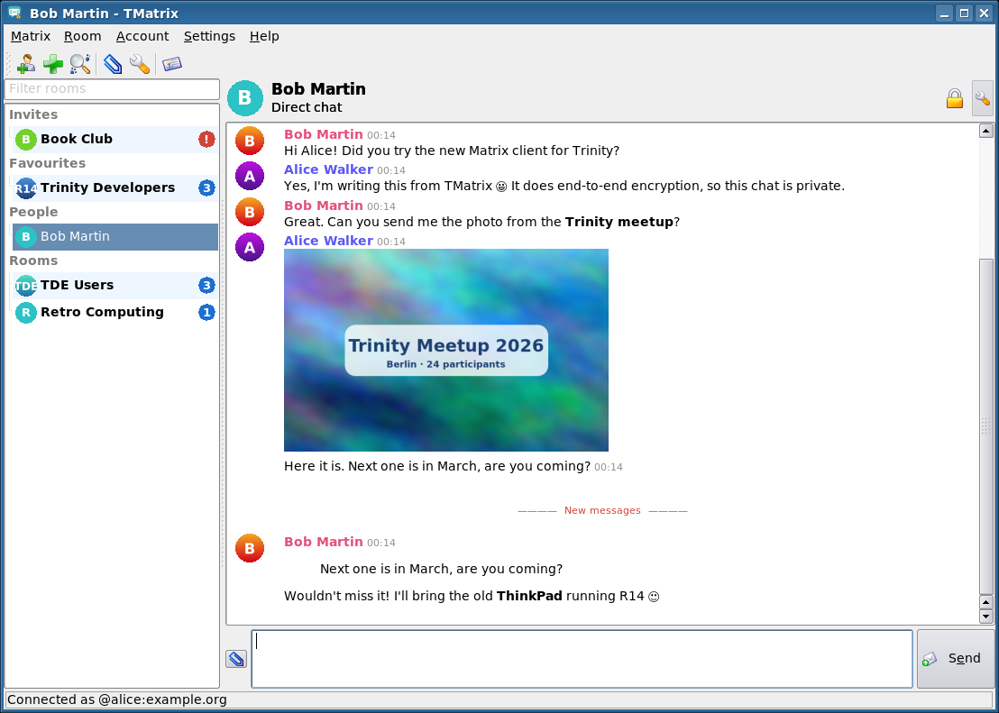
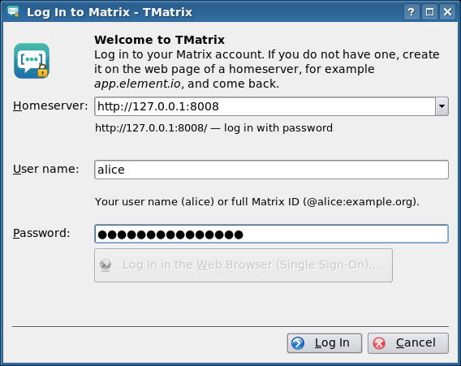
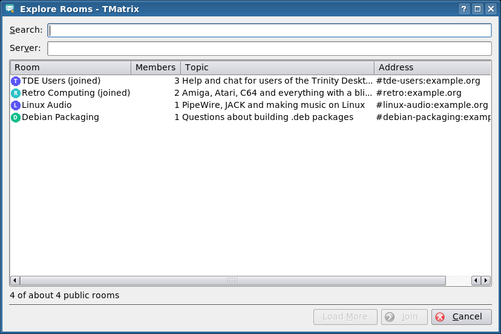
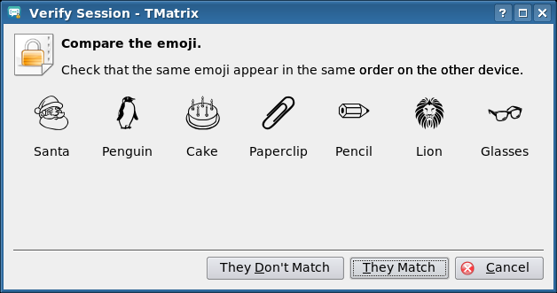
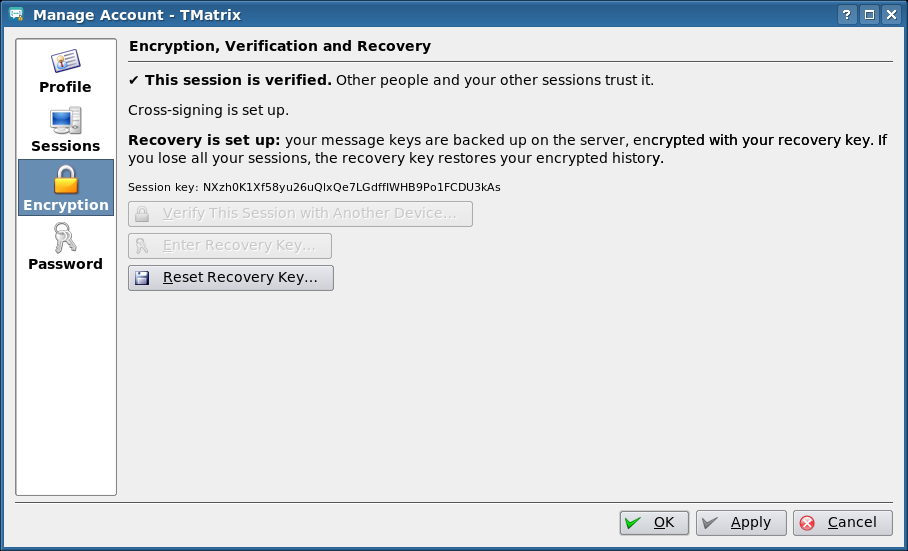
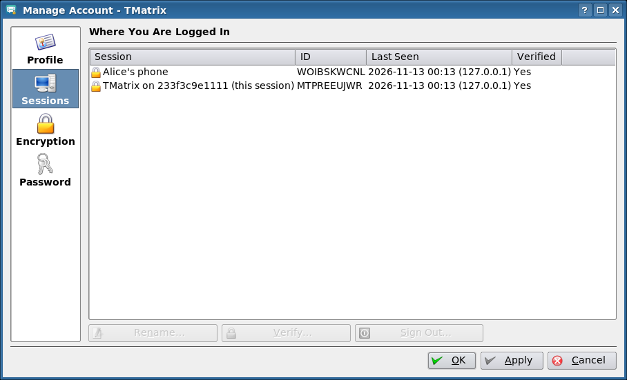
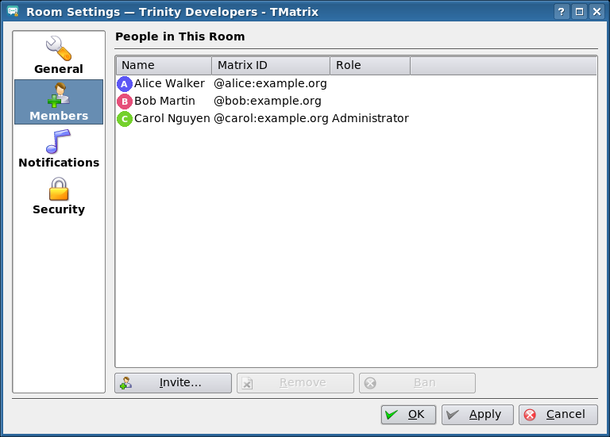
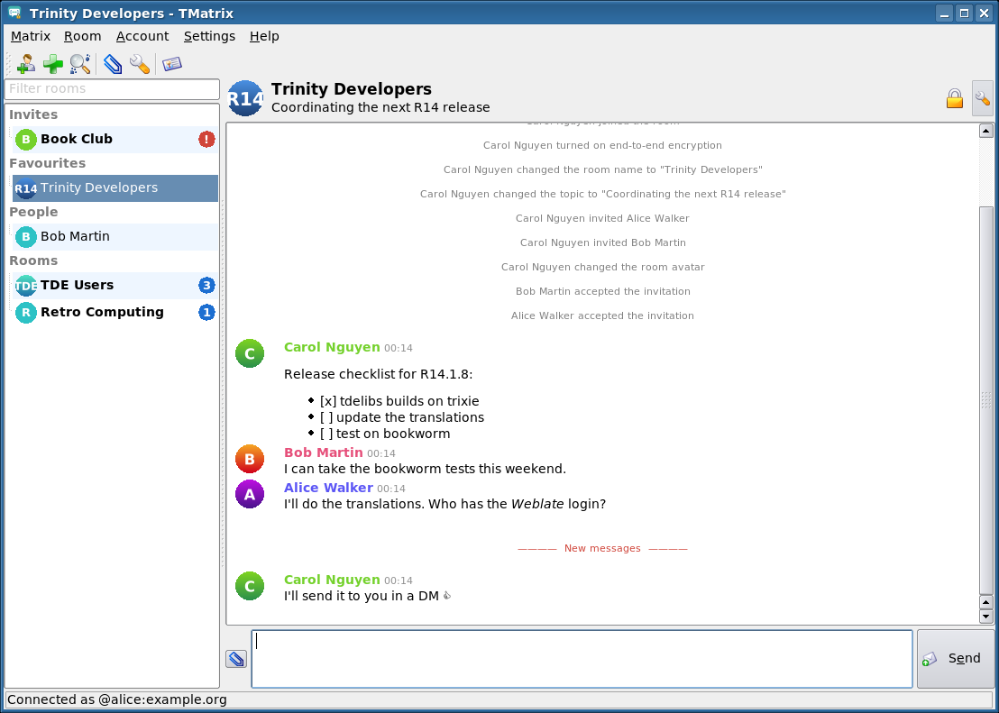
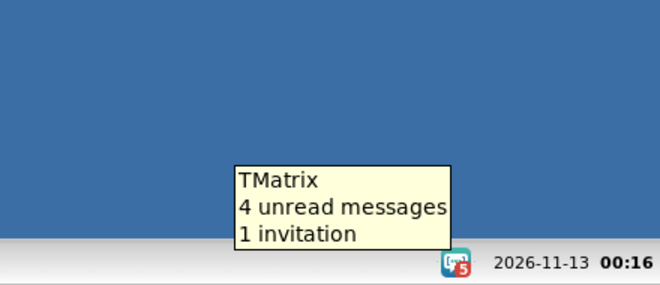
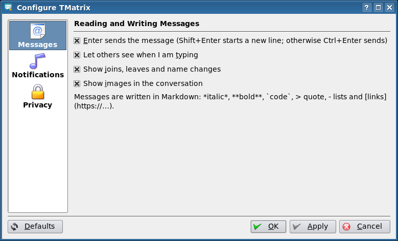

# TMatrix (tde-tmatrix)

A [Matrix](https://en.wikipedia.org/wiki/Matrix_(protocol)) chat client for the
[Trinity Desktop Environment](https://www.trinitydesktop.org/), with end-to-end
encryption.

> **Vibecode disclaimer.** This project was written largely by an AI coding
> assistant (Claude Code), with a human giving direction ("vibe coded"). It
> has been built and tested against a real Synapse homeserver, but the code has
> **not** been carefully reviewed or audited by a person. The cryptography
> itself is not home-made: it comes from the Matrix project's own
> [matrix-rust-sdk](https://github.com/matrix-org/matrix-rust-sdk) and
> [vodozemac](https://github.com/matrix-org/vodozemac). The code that connects
> them to the user interface is new, though, and could have bugs that matter
> for privacy. Use it at your own risk; it comes with no warranty of any kind
> (see [COPYING](COPYING)). Reviews, bug reports and patches are very welcome.
>
> TMatrix is **not affiliated with or endorsed by The Matrix.org Foundation
> or Element**.



## Features

* **Direct chats and rooms**: grouped into invites, favourites, people, rooms
  and low priority, newest first, with unread and mention counts and a filter
* **End-to-end encryption** (Olm/Megolm through matrix-rust-sdk): encrypted
  direct chats and private rooms, encrypted pictures and files
* **Verification** of your own sessions and of other people by comparing
  emoji, with a warning on messages from unverified sessions
* **Recovery**: server-side key backup protected by a recovery key, and
  cross-signing set up automatically
* **Messages**: Markdown, replies, edits (Up edits the last one), reactions,
  deleting, `/me`, read markers, typing notifications, date separators
* **Media**: pictures shown in the conversation, files to open or save,
  sending by button, `Ctrl+U` or drag and drop, user and room avatars
* **Rooms and invites**: create rooms (public with an address, or private and
  encrypted), explore the room directory of any server, join by address,
  accept or decline invitations, invite, remove and ban members, room name,
  topic and picture, notification setting per room, favourites, leave
* **Account management**: display name and picture, sessions (rename, verify,
  sign out), change password, several accounts, logout
* **Login** with password or single sign-on (in the web browser); the login
  is kept in the TDE Wallet and the local data is stored encrypted
* **System tray icon** with the unread count (grey when offline), optional
  start at login, and **notifications** through KNotify for messages,
  mentions, invitations and verification requests
* A **handbook** in KHelpCenter and a man page `tde-tmatrix(1)`

Not supported yet: voice and video calls, threads (thread messages show up in
the conversation), spaces, polls (shown read-only), QR code verification,
creating accounts.

## Screenshots

| | |
|---|---|
|  |  |
| Logging in with a password or single sign-on | The public room directory |
|  |  |
| Verifying a session by comparing emoji | Encryption, verification and recovery |
|  |  |
| The sessions of the account | Members of a room |
|  |  |
| An encrypted room with a Markdown list | Unread messages in the system tray |
|  | |
| Settings | |

## How it works

The Matrix protocol, the encrypted stores (SQLite) and all cryptography are
handled by [matrix-rust-sdk](https://github.com/matrix-org/matrix-rust-sdk)
0.19, the library behind Element X, in a small Rust crate
([`core/`](core/)). It is linked statically into the TQt/TDE program and talks
to it through a tiny C interface: the user interface sends commands as JSON and
receives events (room updates, timeline changes, verification steps, ...) as
JSON, woken up by an eventfd.

```
src/   TDE user interface (C++, TQt 3 / tdelibs)
core/  Matrix engine (Rust, matrix-sdk + matrix-sdk-ui), C ABI in core/include/tmatrix_core.h
doc/   handbook (DocBook) and man page
tools/ build image, local Synapse for tests, screenshot script
```

## Installing

Packages for Debian bookworm and trixie are built by GitHub Actions for every
release (see *Releases*), and are published in the
[Trinity apps APT repository](https://github.com/Yjlion/tde-apt).

```sh
sudo apt install ./tde-tmatrix-trinity_0.1.0+trixie_amd64.deb
```

## Building

You need the Trinity development packages (`tde-cmake`,
`tdelibs14-trinity-dev`, `libtqt3-mt-dev`, `libtqtinterface-dev`) and **Rust
1.96 or newer** from [rustup](https://rustup.rs/) (Debian's own Rust is too
old for matrix-rust-sdk). The first build downloads the Rust crates from
crates.io and takes several minutes.

```sh
mkdir build && cd build
cmake .. -DCMAKE_INSTALL_PREFIX=/opt/trinity
make -j$(nproc)
sudo make install
```

Or build the Debian package: `dpkg-buildpackage -us -uc -b`.

A Docker image with everything needed (TDE, Rust, Synapse, Xvfb) is in
[`tools/Dockerfile`](tools/Dockerfile):

```sh
docker build -t tde-tmatrix-build tools/
docker run --rm -v "$PWD":/src tde-tmatrix-build /src/tools/build.sh
```

### Tests

`core/tests/synapse.rs` drives two engines (alice and bob) through the same
JSON commands the user interface uses against a local Synapse: login, an
encrypted room with an invitation, Markdown, replies, the room directory and
joining by alias, an encrypted image upload and download, emoji verification
of another user and of a second session of the same user (which then decrypts
the older messages), recovery and the session list.

```sh
tools/synapse/start-synapse.sh          # Synapse from pip, see the script
cd core && TMATRIX_TEST_HOMESERVER=http://127.0.0.1:8008 cargo test --release
```

The screenshots are made by [`tools/take-screenshots.sh`](tools/take-screenshots.sh)
under Xvfb against that Synapse with conversations made by
[`tools/synapse/seed.py`](tools/synapse/seed.py).

## License

GPL-2.0-or-later, see [COPYING](COPYING). The handbook is under the GNU FDL.
matrix-rust-sdk and vodozemac are under the Apache License 2.0.
